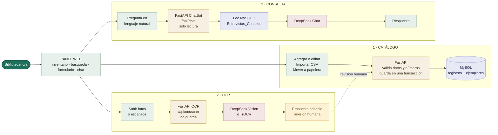
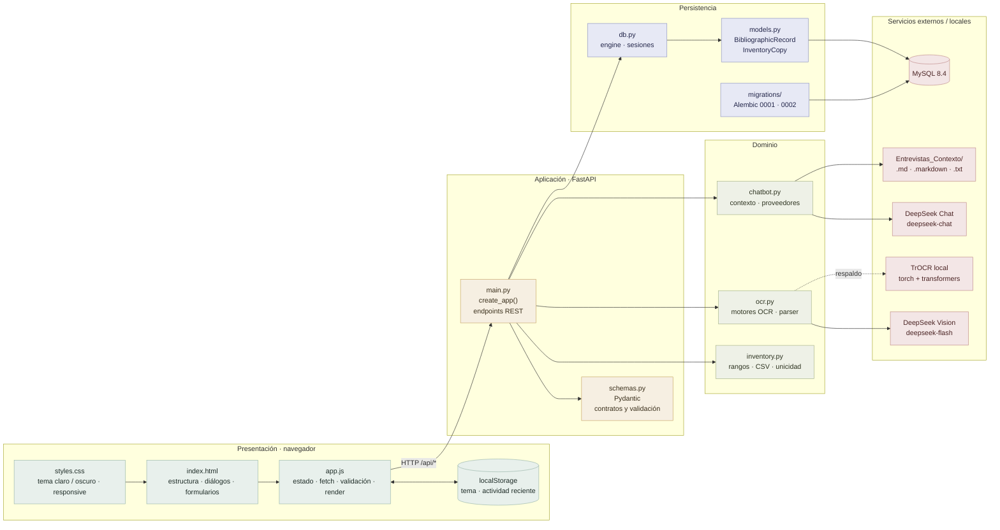
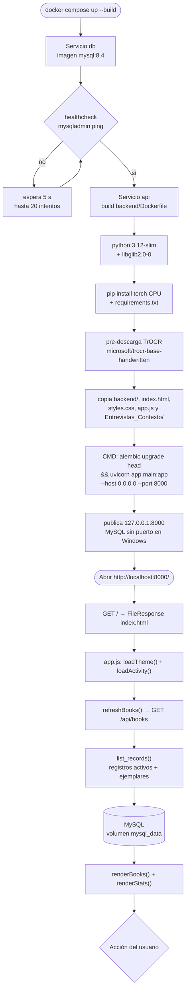
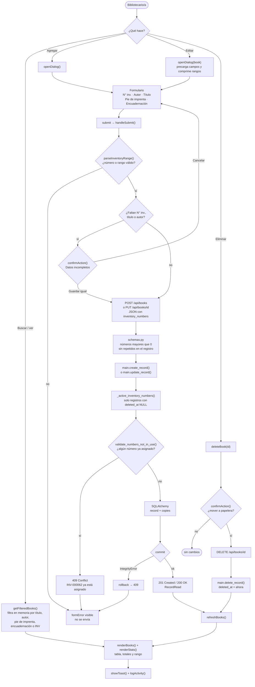
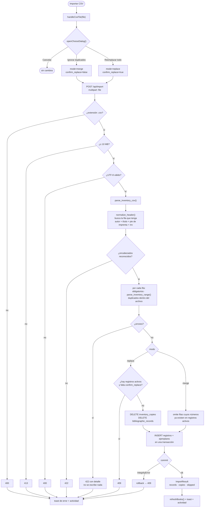
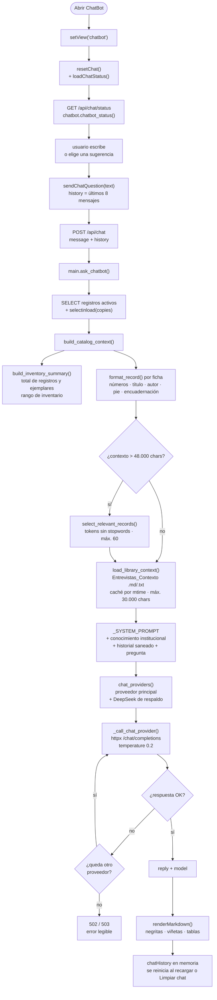
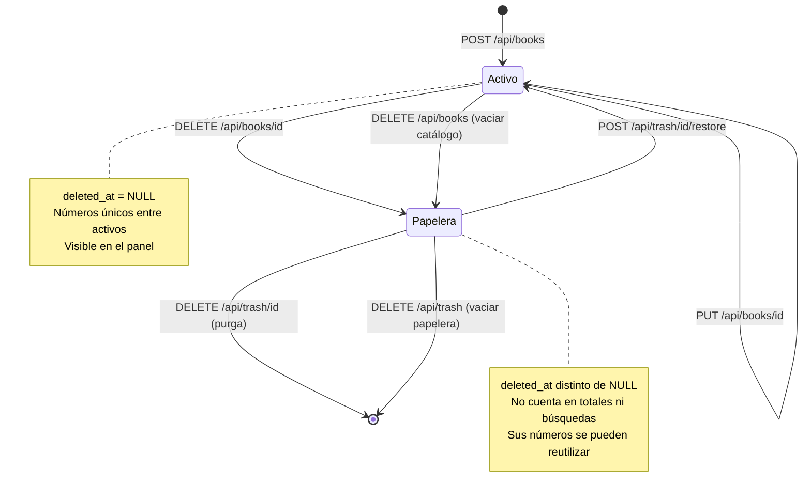
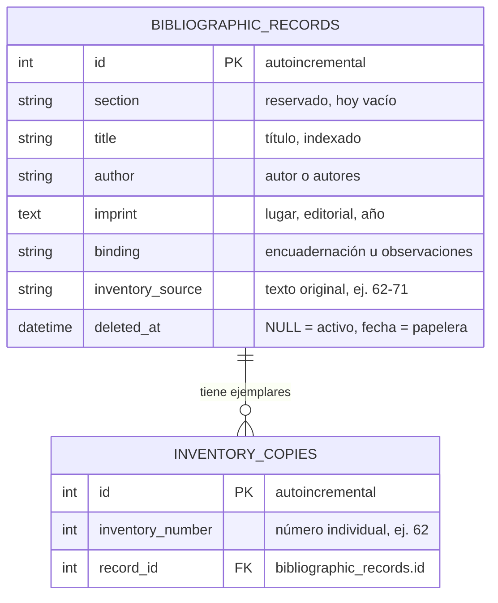

# Diagrama de flujo — Inventario de Biblioteca

Documento de referencia del sistema **tal como está implementado hoy**. Reúne el panorama general, los flujos de cada función, las capas técnicas, el modelo de datos y el mapa de funciones/endpoints. El código Mermaid está listo para pegarse en un renderizador y exportar la imagen.

> **Versión del proyecto:** panel administrativo de una sola persona, sin autenticación, con FastAPI + MySQL + OCR (DeepSeek/TrOCR) + ChatBot (DeepSeek).

---

## Índice

1. [Cómo generar la imagen](#cómo-generar-la-imagen)
2. [Diagrama 1 — Panorama general](#diagrama-1--panorama-general)
3. [Diagrama 2 — Arquitectura por capas](#diagrama-2--arquitectura-por-capas)
4. [Diagrama 3 — Arranque y despliegue](#diagrama-3--arranque-y-despliegue)
5. [Diagrama 4 — Catálogo: ver, agregar, editar y eliminar](#diagrama-4--catálogo-ver-agregar-editar-y-eliminar)
6. [Diagrama 5 — Importación de CSV](#diagrama-5--importación-de-csv)
7. [Diagrama 6 — OCR de fichas escaneadas](#diagrama-6--ocr-de-fichas-escaneadas)
8. [Diagrama 7 — ChatBot del inventario](#diagrama-7--chatbot-del-inventario)
9. [Diagrama 8 — Papelera y borrado](#diagrama-8--papelera-y-borrado)
10. [Diagrama 9 — Modelo de datos](#diagrama-9--modelo-de-datos)
11. [Mapa de endpoints](#mapa-de-endpoints)
12. [Mapa de funciones del frontend](#mapa-de-funciones-del-frontend)
13. [Mapa de funciones del backend](#mapa-de-funciones-del-backend)
14. [Lo que hay detrás: stack, variables y límites](#lo-que-hay-detrás-stack-variables-y-límites)

---

## Cómo generar la imagen

### Opción recomendada: renderizar Mermaid (texto nítido y fiel)

El archivo [`diagrama_panorama.mmd`](./diagrama_panorama.mmd) contiene solo el diagrama principal, listo para importar.

| Herramienta | Pasos |
| --- | --- |
| **Mermaid Live** (`mermaid.live`) | Pegá el contenido del `.mmd`, ajustá tema/fondo y usá **Actions → Download PNG/SVG**. Para calidad de impresión, exportá **SVG** y luego convertí a PNG a 2× o 3×. |
| **draw.io / diagrams.net** | **Arrange → Insert → Advanced → Mermaid**, pegá el código y luego **File → Export as → PNG/SVG**. |
| **VS Code** | Extensión *Markdown Preview Mermaid Support* para previsualizar, o *Mermaid Chart* para exportar. |
| **CLI (Mermaid CLI)** | `npx -y @mermaid-js/mermaid-cli -i diagrama_panorama.mmd -o diagrama_panorama.png -w 2400 -b "#fbfaf7"` |

Recomendaciones de exportación: fondo claro (`#fbfaf7`), escala 2×, PNG con transparencia desactivada, SVG si después vas a editar.

### Si usás un generador de imágenes por IA

Los generadores de imágenes suelen **deformar el texto**. Si igual querés uno estético, usá este prompt y después corregí los rótulos:

> Diagrama de flujo técnico y limpio, estilo flat, fondo claro color hueso, paleta verde salvia, beige y grafito, tipografía sans-serif legible, cajas redondeadas con bordes finos, flechas sutiles. Organizado en cuatro columnas de izquierda a derecha: **Panel web (navegador)** → **API FastAPI** → **Servicios (OCR y ChatBot)** → **MySQL**. Arriba, una franja de arranque con Docker Compose, healthcheck de MySQL, migraciones Alembic y Uvicorn. Debajo del panel, seis ramas: agregar/editar, importar CSV, leer imágenes, consultar ChatBot, eliminar a papelera y exportar CSV. Sin texto inventado, sin iconos recargados, estilo diagrama de arquitectura profesional.

---

## Diagrama 1 — Panorama general

Vista única del sistema: arranque, panel, acciones del usuario, API, servicios externos y persistencia.

**Lectura rápida:** el panel nunca habla directo con MySQL ni con DeepSeek. Todo pasa por FastAPI. MySQL solo es alcanzable dentro de la red de Docker. El OCR y el ChatBot **solo leen/proponen**: no escriben en la base por su cuenta.

---

## Diagrama 2 — Arquitectura por capas

Qué archivo cumple cada rol y con qué tecnología.

**Capas:**

- **Presentación:** HTML/CSS/JS sin framework. `app.js` guarda el catálogo en memoria (`books`), hace `fetch` y renderiza la tabla. El tema y la actividad reciente viven en `localStorage`, no en MySQL.
- **Aplicación:** FastAPI expone REST, valida con Pydantic y orquesta las transacciones. `create_app()` permite inyectar otra base (tests con SQLite en memoria).
- **Dominio:** `inventory.py` interpreta rangos y CSV; `ocr.py` propone fichas; `chatbot.py` arma el contexto y elige proveedor.
- **Persistencia:** SQLAlchemy 2 + PyMySQL. Alembic aplica migraciones al iniciar el contenedor.
- **Externos:** DeepSeek (visión y chat), TrOCR local de respaldo y la carpeta de entrevistas/normas.

---

## Diagrama 3 — Arranque y despliegue

**Detalles de infraestructura:**

- MySQL 8.4 usa el volumen `mysql_data`; `docker compose down -v` lo borra.
- La API espera `depends_on: condition: service_healthy`.
- El puerto queda atado a `127.0.0.1`: no se accede desde otros dispositivos de la red.
- Al iniciar, Alembic aplica `0001_initial_catalog` y `0002_trash`.
- `HF_HOME=/opt/huggingface` cachea el modelo TrOCR dentro de la imagen.

---

## Diagrama 4 — Catálogo: ver, agregar, editar y eliminar

**Reglas clave:**

- El frontend valida formato y muestra un diálogo propio si faltan datos; el backend acepta registros incompletos si el usuario confirma.
- Un número de inventario solo puede pertenecer a **un registro activo**. Los registros en papelera liberan sus números.
- Al editar, el conjunto de ejemplares se **reemplaza** por el rango nuevo; no se hace merge por número.
- La unicidad global de `inventory_number` se quitó en la migración `0002`; la valida la aplicación entre registros activos.
- `section` existe en el modelo pero la interfaz siempre la guarda vacía (reservada).

---

## Diagrama 5 — Importación de CSV

**Detalles importantes:**

- El parser **ignora filas de título/resumen** anteriores al encabezado y detecta columnas por nombre normalizado (sin acentos ni signos).
- Rangos inclusivos (`62-71`) se expanden a números individuales; también acepta listas (`62, 65, 78`) en la interfaz.
- `replace` borra **todo** el catálogo, incluidos los registros que estén en la papelera, y exige confirmación si hay activos.
- `merge` no borra nada: omite la fila completa si alguno de sus números ya está activo.
- Si una sola fila falla, se rechaza la importación completa (validación atómica).
- El CSV de origen tiene 195 registros y 751 ejemplares (según el README).

---

## Diagrama 6 — OCR de fichas escaneadas

Flujo completo desde la selección de imágenes hasta el guardado, con los dos motores.

```mermaid
flowchart TD
  A(["Leer imágenes<br/>1 a N fotos o escaneos"]) --> B["handleOcrFiles(files)"]
  B --> C["GET /api/ocr/status<br/>ocr.ocr_status()"]
  C --> C1{"¿available?"}
  C1 -->|"no"| E0["503<br/>falta API key o modelo"]
  C1 -->|"sí"| LOOP["por cada imagen<br/>validateImageFile()<br/>tipo de imagen y ≤ 20 MB"]
  LOOP --> UP["POST /api/ocr/scan<br/>multipart: file"]

  UP --> MV["main.scan_record_image()<br/>extensión o content-type<br/>tamaño y archivo no vacío"]
  MV --> MOT{"ocr.selected_engine()"}

  MOT -->|"deepseek"| DS["Motor DeepSeek Vision"]
  MOT -->|"trocr"| TR["Motor TrOCR local"]

  subgraph SD["Motor DeepSeek"]
    direction TB
    DS --> DS1["_encode_image_for_api()<br/>EXIF · JPEG · base64"]
    DS1 --> DS2["httpx POST /chat/completions<br/>prompt: una línea por libro<br/>inv | autor | título | encuadernación | pie"]
    DS2 --> DS3["_clean_model_text()"]
    DS3 --> INT["interpret_ocr_records_text()<br/>divide por | y arma propuestas"]
    INT --> CHK{"looks_like_inventory_records()<br/>¿número válido + título o autor?"}
    CHK -->|"no"| REJ["422<br/>no parece inventario"]
  end

  subgraph ST["Motor TrOCR"]
    direction TB
    TR --> TR1["_get_model()<br/>carga perezosa de TrOCR + torch"]
    TR1 --> TR2["_prepare_gray()<br/>PIL · EXIF · autocontraste · resize"]
    TR2 --> TR3["_candidate_orientations()<br/>0°/90°/270°/180° + _segment() OpenCV"]
    TR3 --> TR4["_read_crops()<br/>prueba 6 segmentos, lee hasta 80<br/>_recognize() = texto + confianza"]
    TR4 --> TR5["interpret_ocr_text()<br/>etiquetas · rangos · título y autor"]
    TR5 --> CHK2{"looks_like_inventory_records()"}
    CHK2 -->|"no"| REJ
  end

  CHK -->|"sí"| RES["OCRScanResult<br/>records · engine · confidence<br/>raw_text · width/height · warnings"]
  CHK2 -->|"sí"| RES

  RES --> COMB["combineOcrResults()<br/>une las propuestas de todas las imágenes"]
  COMB --> N{"¿cuántos registros<br/>en total?"}
  N -->|"1"| FORM["showOcrSuggestion()<br/>formulario Agregar registro precargado"]
  N -->|"varios"| MULTI["openScanRecords()<br/>tabla editable, una fila por libro"]
  FORM --> SAVE["usuario corrige y guarda<br/>POST o PUT /api/books"]
  MULTI --> SAVE2["saveScanRecords()<br/>rangos · datos incompletos<br/>duplicados dentro del lote"]
  SAVE2 --> DUP{"¿números ya presentes<br/>en el catálogo?"}
  DUP -->|"sí"| ASK{"Omitir duplicados<br/>o cancelar y corregir"}
  ASK -->|"omitir"| BULK["POST /api/books/bulk<br/>on_conflict=skip"]
  ASK -->|"cancelar"| MULTI
  DUP -->|"no"| BULK
  BULK --> REF["refreshBooks() + toast + actividad"]
  SAVE --> REF
```

**Garantías del OCR:**

- **Nunca escribe en la base:** devuelve una propuesta editable.
- Rechaza imágenes que no parezcan planillas de inventario (fotos, paisajes, comprobantes) con `422`.
- Formatos: PNG, JPG, TIFF, BMP, WEBP, GIF y HEIC/AVIF si `pillow-heif` está instalado.
- Límite: 20 MB por imagen. Varias imágenes se procesan en orden con progreso.
- `OCR_ENGINE` fuerza `deepseek` o `trocr`; si está vacío, usa DeepSeek cuando hay `DEEPSEEK_API_KEY` y TrOCR como respaldo.
- En el guardado múltiple, las filas con números ya usados se resaltan; el usuario puede omitirlas o corregirlas.

---

## Diagrama 7 — ChatBot del inventario

**Qué usa el asistente:**

1. El **inventario en vivo** (registros activos, títulos, autores, pie de imprenta, encuadernación y números).
2. La **base de conocimiento institucional** de `Entrevistas_Contexto/` (préstamos, asociación, sanciones, horarios, computadoras).
3. El **historial reciente** del navegador (máximo 8 mensajes).

**Reglas y límites:**

- No modifica la base: solo lee.
- Si el libro no está en el catálogo, lo dice; si la pregunta no está en las fuentes, pide reformular.
- Si el proveedor principal se queda sin saldo/cuota (`401`, `402`, `403`, `429` o error de red), reintenta con DeepSeek.
- Si falta la API key, `GET /api/chat/status` devuelve `available: false`.
- El historial vive en memoria del navegador, no en `localStorage` ni en MySQL.

---

## Diagrama 8 — Papelera y borrado

**Comportamiento:**

- Eliminar **no borra**: marca `deleted_at` y mueve a papelera.
- Restaurar falla con `409` si algún número ya fue reutilizado por un registro activo.
- La purga individual borra en cascada sus ejemplares (`ON DELETE CASCADE`).
- Vaciar la papelera elimina primero los ejemplares y después los registros.
- El borrado definitivo no se puede deshacer.

---

## Diagrama 9 — Modelo de datos

**Relación:** un registro bibliográfico tiene **muchos** ejemplares. Un rango como `62-71` no crea diez fichas: crea **diez filas** en `inventory_copies` asociadas al mismo registro.

**Unicidad:** no hay restricción única global en la base (se quitó en `0002_trash`). La API valida que un número no se repita entre registros **activos**, lo que permite reutilizar números de registros en papelera.

---

## Mapa de endpoints

Todos los endpoints viven en `backend/app/main.py`.

| Método | Ruta | Handler | Qué hace |
| --- | --- | --- | --- |
| `GET` | `/api/health` | `health` | `SELECT 1` contra MySQL. |
| `GET` | `/api/books` | `list_records` | Lista registros activos con sus números de inventario. |
| `POST` | `/api/books` | `create_record` | Crea un registro y sus ejemplares. `201`; `409` si un número ya existe. |
| `POST` | `/api/books/bulk` | `create_records_bulk` | Crea varios registros en una transacción. `on_conflict=skip` omite filas con números ya usados. |
| `PUT` | `/api/books/{id}` | `update_record` | Actualiza campos y **reemplaza** el conjunto de ejemplares. `404` / `409`. |
| `DELETE` | `/api/books/{id}` | `delete_record` | Mueve un registro a la papelera (`deleted_at`). `204`. |
| `DELETE` | `/api/books` | `delete_all_records` | Mueve **todo** el catálogo activo a la papelera. |
| `GET` | `/api/trash` | `list_trash` | Lista registros con `deleted_at` no nulo. |
| `POST` | `/api/trash/{id}/restore` | `restore_record` | Restaura si no hay conflicto de números. `409` si lo hay. |
| `DELETE` | `/api/trash/{id}` | `purge_record` | Borra definitivamente un registro y sus ejemplares. `204`. |
| `DELETE` | `/api/trash` | `empty_trash` | Vacía la papelera completa. |
| `POST` | `/api/import` | `replace_catalog` | Importa CSV. `mode=replace` reemplaza todo; `mode=merge` agrega solo lo nuevo. |
| `GET` | `/api/ocr/status` | `ocr_status` | Motor activo, disponibilidad y formatos admitidos. |
| `POST` | `/api/ocr/scan` | `scan_record_image` | Lee una imagen y devuelve propuestas. **No persiste.** |
| `GET` | `/api/chat/status` | `chatbot_status` | Modelo, respaldo y cantidad de archivos de contexto. |
| `POST` | `/api/chat` | `ask_chatbot` | Responde con inventario + conocimiento institucional. **No persiste.** |
| `GET` | `/` | `index` | Sirve `index.html`. |
| `GET` | `/styles.css` | `styles` | Sirve la hoja de estilos. |
| `GET` | `/app.js` | `script` | Sirve el JavaScript del panel. |

**Códigos de error frecuentes:** `400` archivo/extensión inválida, `401/402/403` clave/saldo del proveedor, `404` registro inexistente, `409` conflicto de inventario o confirmación faltante, `413` archivo demasiado grande, `422` validación/OCR no reconocido, `429` cuota del asistente, `502` fallo del proveedor, `503` OCR/chat no disponible.

---

## Mapa de funciones del frontend

Archivo: `app.js`.

### Arranque, estado y navegación

| Función | Qué hace |
| --- | --- |
| `applyTheme(theme)` / `loadTheme()` / `toggleTheme()` | Aplican y guardan el tema claro/oscuro en `localStorage` (`biblioteca-tema`). |
| `apiRequest(url, options)` | Envuelve `fetch`, normaliza errores JSON y distingue “API caída” de “abierto como archivo”. |
| `refreshBooks()` | `GET /api/books`, actualiza `books`, renderiza y marca el estado de conexión. |
| `fromApiRecord(record)` | Convierte el JSON de la API al modelo interno en camelCase. |
| `setView(view)` | Alterna Inventario / ChatBot, actualiza breadcrumb y foco. |
| `showToast(message)` | Aviso temporal no bloqueante. |
| `openChoiceDialog({...})` | Diálogo de decisión con botones propios (reemplaza `confirm`). |
| `confirmAction(message, config)` | Atajo de confirmación sí/no. |

### Catálogo

| Función | Qué hace |
| --- | --- |
| `getFilteredBooks()` | Filtra por título, autor, pie de imprenta, encuadernación, `inventory_source` o `INV-000062`. |
| `renderBooks()` / `renderStats()` | Dibujan tabla, contadores, rango y estado vacío. |
| `formatInventoryNumber(number)` | `62` → `INV-000062`. |
| `parseInventoryRange(value)` | Acepta `62`, `62-71`, `62, 65, 78`; valida ascendencia, positivos y tope de 10.000. |
| `inventoryText(numbers)` | Compacta números consecutivos para mostrarlos como rangos. |
| `compressNumbers(numbers)` | Convierte la lista a texto editable para el formulario. |
| `openDialog(book)` | Abre el formulario vacío o precargado para editar. |
| `handleSubmit(event)` | Valida, confirma datos incompletos, envía `POST` o `PUT` y refresca. |
| `deleteBook(id)` | Confirma y envía `DELETE /api/books/{id}`. |
| `clearCatalog()` | Doble confirmación y `DELETE /api/books` (todo a papelera). |
| `exportCsv()` | Descarga la **vista filtrada** con los encabezados originales del catálogo. |

### Papelera

| Función | Qué hace |
| --- | --- |
| `loadTrash()` / `refreshTrashCount()` | `GET /api/trash` y actualizan el contador. |
| `renderTrash()` / `openTrash()` | Dibujan el diálogo de papelera con fecha de eliminación. |
| `restoreRecord(id)` | `POST /api/trash/{id}/restore`. |
| `purgeRecord(id)` | `DELETE /api/trash/{id}` con confirmación. |
| `emptyTrash()` | `DELETE /api/trash` con confirmación. |

### CSV

| Función | Qué hace |
| --- | --- |
| `handleCsvFile(file)` | Pregunta `replace` o `merge`, envía `POST /api/import`, refresca y registra actividad. |

### OCR

| Función | Qué hace |
| --- | --- |
| `handleOcrFiles(fileList)` | Orquesta estado, progreso, escaneo de cada imagen y combinación de resultados. |
| `getOcrStatus()` | Cachea `GET /api/ocr/status`. |
| `validateImageFile(file)` | Valida tipo de imagen y 20 MB antes de subir. |
| `combineOcrResults(successes)` | Une registros, advertencias, motores y confianza promedio. |
| `showOcrSuggestion(result, imageUrl)` | Con **una** ficha, precarga el formulario y muestra la imagen. |
| `fillFormFromOcr(result)` | Copia los campos reconocidos al formulario. |
| `openScanRecords(...)` / `renderScanRecords()` / `scanRowTemplate()` | Con **varias** fichas, abren la tabla editable “Registros detectados”. |
| `saveScanRecords()` | Valida rangos, confirma datos incompletos, detecta duplicados y guarda con `POST /api/books/bulk`. |
| `setOcrBusy(busy, message)` | Muestra el indicador “Escaneando imagen N de M”. |
| `describeOcrError(error)` / `reportOcrError(error)` | Traducen `400/413/422/503` a mensajes claros y registran actividad. |
| `resetOcrPreview()` / `resetScanPreview()` | Liberan object URLs y limpian vistas previas. |

### ChatBot y Markdown

| Función | Qué hace |
| --- | --- |
| `sendChatQuestion(question)` | Envía `POST /api/chat` con los últimos 8 mensajes y muestra “Pensando…”. |
| `appendChatMessage(role, text)` | Agrega una burbuja al chat. |
| `renderMarkdown(text)` | Renderiza negritas, listas, enlaces y tablas de la respuesta. |
| `renderInline`, `splitTableRow`, `renderMarkdownTable` | Helpers del renderizador Markdown. |
| `resetChat()` / `loadChatStatus()` | Reinician la conversación y consultan modelo/contexto. |

### Actividad reciente

| Función | Qué hace |
| --- | --- |
| `loadActivity()` / `saveActivity()` | Leen y guardan hasta 60 entradas en `localStorage` (`biblioteca-actividad`). |
| `logActivity(message, kind)` | Agrega un evento (`ok`, `warn`, `error`, `info`). |
| `renderActivity()` / `clearActivity()` | Dibujan o vacían el popup. |
| `escapeHTML(value)` | Evita inyección al interpolar datos en el HTML. |

---

## Mapa de funciones del backend

### `backend/app/main.py`

| Función | Qué hace |
| --- | --- |
| `create_app(database_url, frontend_dir, create_schema)` | Fábrica de la app: engine, sesión, rutas, archivos estáticos y lifespan. |
| `_utcnow()` | Fecha UTC sin zona para `deleted_at`. |
| `_active_inventory_numbers(session, exclude_record_id)` | Números usados por registros **activos**; permite excluir el registro que se edita. |
| `health`, `list_records`, `create_record`, `create_records_bulk`, `update_record`, `delete_record`, `delete_all_records` | CRUD del catálogo. |
| `list_trash`, `restore_record`, `purge_record`, `empty_trash` | Papelera. |
| `replace_catalog` | Importación CSV atómica (`replace` / `merge`). |
| `ocr_status`, `scan_record_image` | Estado y escaneo OCR. |
| `chatbot_status`, `ask_chatbot` | Estado y consulta del asistente. |
| `index`, `styles`, `script` | Sirven el panel y sus assets con `Cache-Control: no-store`. |

### `backend/app/inventory.py`

| Función | Qué hace |
| --- | --- |
| `parse_inventory_range(value)` | Convierte `62` o `62-71` en lista de enteros; rechaza rangos descendentes, cero y más de 10.000. |
| `normalize_header(value)` | Quita acentos/signos y pasa a minúsculas para reconocer columnas. |
| `parse_inventory_csv(text, ignore_duplicates)` | Busca encabezados, valida filas, expande rangos y detecta duplicados. |
| `record_to_dict(record)` | Serializa un registro y sus ejemplares para la API. |
| `validate_numbers_not_in_use(numbers, in_use)` | Lanza `409` con el primer número ocupado. |

### `backend/app/ocr.py`

| Función | Qué hace |
| --- | --- |
| `selected_engine()` | Decide `deepseek` o `trocr` según `OCR_ENGINE` y la API key. |
| `scan_image_bytes(data)` | Punto de entrada del OCR. |
| `_scan_with_deepseek(data)` | Reencoda a JPEG, llama a la API de visión y parsea la respuesta. |
| `_scan_with_trocr(data)` | Carga TrOCR, segmenta, reconoce líneas y elige la mejor orientación. |
| `interpret_ocr_records_text(text)` | Convierte líneas `inv | autor | título | encuadernación | pie` en propuestas. |
| `interpret_ocr_text(text)` | Intérprete de un solo registro: etiquetas, rangos, heurísticas de título/autor/pie. |
| `looks_like_inventory_records(records)` | Exige al menos una fila con número plausible y título o autor. |
| `_prepare_gray`, `_segment`, `_candidate_orientations`, `_read_crops`, `_recognize` | Preprocesamiento OpenCV/PIL y reconocimiento TrOCR. |
| `ocr_status()` | Devuelve disponibilidad, motor, modelo y formatos. |

### `backend/app/chatbot.py`

| Función | Qué hace |
| --- | --- |
| `answer_question(records, message, history)` | Arma contexto, elige proveedor, llama y devuelve `reply` + `model`. |
| `build_catalog_context(records, question)` | Resumen + fichas; recorta por relevancia si supera 48.000 caracteres. |
| `build_inventory_summary(records)` | Totales de registros/ejemplares y rango de inventario. |
| `format_record(record)` | Ficha compacta `números | «título» | autor | pie | encuadernación`. |
| `select_relevant_records(records, question)` | Puntúa fichas por tokens de la pregunta (sin stopwords), máximo 60. |
| `load_library_context()` | Lee `.md/.markdown/.txt` de `Entrevistas_Contexto/`, cachea por `mtime`. |
| `chat_providers()` / `fallback_model()` | Cadena principal + respaldo DeepSeek. |
| `_call_chat_provider(httpx, provider, messages)` | POST OpenAI-compatible y traducción de errores. |
| `chatbot_status()` | Disponibilidad, modelo, respaldo y archivos de contexto. |
| `_sanitize_history(history)` | Limita a 8 mensajes y 2.000 caracteres por mensaje. |

### `backend/app/schemas.py`, `models.py`, `db.py`, `config.py`

| Archivo | Función |
| --- | --- |
| `schemas.py` | `RecordCreate`, `RecordUpdate`, `RecordRead`, `ImportResult`, `BulkCreateResult`, `DeleteAllResult`, `OCRScanResult`, `ChatRequest`, `ChatReply`, `ChatbotStatus`. Valida números > 0 y sin repetidos. |
| `models.py` | `BibliographicRecord` (1) ↔ `InventoryCopy` (N), cascada y `deleted_at`. |
| `db.py` | `make_session_factory()` crea engine y sesión; activa claves foráneas en SQLite para tests. |
| `config.py` | `Settings` lee `DATABASE_URL`, `FRONTEND_DIR` y `TROCR_MODEL` desde `.env`. |

### Migraciones y pruebas

| Archivo | Qué aporta |
| --- | --- |
| `migrations/versions/0001_initial_catalog.py` | Crea `bibliographic_records` e `inventory_copies` con FK e índice único. |
| `migrations/versions/0002_trash.py` | Agrega `deleted_at` y quita la unicidad global para permitir reutilizar números. |
| `tests/test_api.py` | CRUD, bulk, papelera, importación atómica y migración inicial. |
| `tests/test_inventory.py` | Rangos, CSV real (195 registros / 751 ejemplares) y duplicados. |
| `tests/test_ocr.py` | Interpretación, rechazo de imágenes que no son inventario y errores HTTP. |
| `tests/test_chatbot.py` | Resumen, selección por relevancia, contexto institucional y fallback. |
| `tests/conftest.py` | Fuerza `sqlite+pysqlite:///:memory:` para las pruebas. |

---

## Lo que hay detrás: stack, variables y límites

### Stack técnico

| Capa | Tecnología |
| --- | --- |
| Frontend | HTML5, CSS3, JavaScript ES2020 sin framework. |
| API | Python 3.12, FastAPI, Uvicorn, Pydantic v2. |
| Persistencia | MySQL 8.4, SQLAlchemy 2, PyMySQL, Alembic. |
| OCR principal | DeepSeek Vision (`deepseek-flash`) vía API OpenAI-compatible. |
| OCR de respaldo | TrOCR (`microsoft/trocr-base-handwritten`), PyTorch CPU, Transformers, OpenCV, Pillow. |
| ChatBot | DeepSeek Chat (`deepseek-chat`) u otro proveedor OpenAI-compatible. |
| Infraestructura | Docker Compose, volumen `mysql_data`, puerto `127.0.0.1:8000`. |
| Pruebas | pytest + SQLite en memoria. |

### Variables de entorno principales

| Variable | Uso |
| --- | --- |
| `MYSQL_DATABASE`, `MYSQL_USER`, `MYSQL_PASSWORD`, `MYSQL_ROOT_PASSWORD` | Credenciales de MySQL. |
| `DATABASE_URL` | Cadena que arma Docker Compose para SQLAlchemy. |
| `OCR_ENGINE` | `deepseek` o `trocr`. Vacío = automático. |
| `DEEPSEEK_API_KEY` | Clave compartida por OCR y ChatBot. |
| `DEEPSEEK_BASE_URL`, `DEEPSEEK_MODEL`, `DEEPSEEK_CHAT_MODEL` | Endpoint y modelos. |
| `CHATBOT_API_KEY`, `CHATBOT_BASE_URL`, `CHATBOT_MODEL` | Proveedor alternativo del ChatBot. |
| `DEEPSEEK_TIMEOUT` | Timeout de las llamadas (60 s por defecto). |
| `LIBRARY_CONTEXT_DIR` | Carpeta de conocimiento institucional. |
| `TROCR_MODEL` | Modelo local de respaldo. |

### Decisiones de diseño visibles en el código

- **Una sola persona, sin login:** no hay usuarios, roles ni auditoría en MySQL.
- **Catálogo y ejemplares separados:** permite que un título tenga muchos números sin duplicar la ficha.
- **Rangos expandidos:** `62-71` se guarda como diez ejemplares individuales; el texto original queda en `inventory_source`.
- **Borrado lógico:** la papelera evita pérdidas accidentales; la purga es explícita.
- **Operaciones atómicas:** creación masiva e importación usan transacciones; si algo falla, no queda a medias.
- **OCR como propuesta:** el reconocimiento nunca persiste; siempre hay revisión humana.
- **ChatBot de solo lectura:** responde con el inventario y las entrevistas, pero no modifica nada.
- **Actividad reciente local:** es informativa y vive en el navegador; no es auditoría.
- **Exportación fiel a la vista:** si hay un filtro activo, el CSV exportado solo contiene esas filas.

### Límites conocidos

- Sin autenticación ni permisos.
- Sin versionado de registros: dos ediciones simultáneas del mismo registro pueden pisarse.
- Sin historial de importaciones ni informe descargable de filas omitidas.
- Sin datos individuales de cada ejemplar (estado físico, ubicación, préstamo).
- MySQL no se publica fuera de Docker; el panel está pensado para la PC local.
- El ChatBot depende de un servicio externo y de su cuota/saldo.
- TrOCR puede tardar la primera vez porque carga el modelo en memoria.

---

## Resumen en una frase

**El navegador muestra y valida; FastAPI orquesta y decide; MySQL guarda el catálogo y sus ejemplares; DeepSeek/TrOCR solo proponen lecturas; y el ChatBot solo lee el inventario y las entrevistas para responder.**
