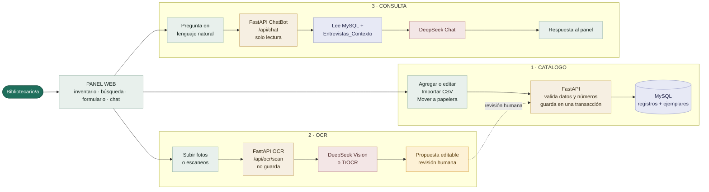

# Diagrama de flujo — Inventario de Biblioteca

Una sola vista, ordenada en tres flujos: **catálogo**, **OCR** y **consulta**. El panel siempre pasa por FastAPI; MySQL es la única fuente de verdad.

## Diagrama principal



### Cómo leerlo

| Flujo | Qué hace | Guarida |
| --- | --- | --- |
| **1 · Catálogo** | Agregar, editar, importar CSV o mover a la papelera. FastAPI valida rangos, duplicados y datos, y guarda en una transacción. | MySQL |
| **2 · OCR** | Sube una o varias imágenes, DeepSeek Vision (o TrOCR de respaldo) las lee y devuelve una propuesta editable. | **Nunca guarda sola**: se revisa y se guarda por el flujo de Catálogo. |
| **3 · Consulta** | El ChatBot lee el inventario activo y las entrevistas/normas internas, y DeepSeek Chat redacta la respuesta. | **Solo lectura**: no modifica la base. |

**Colores:** verde = usuario/panel · beige = FastAPI · lila = datos · rosa = servicios externos · ámbar = propuesta a revisar.

---

## Cómo generar la imagen

El archivo [`diagrama_panorama.mmd`](./diagrama_panorama.mmd) contiene exactamente este diagrama.

1. Abrí **mermaid.live** y pegá el contenido del `.mmd`.
2. Usá **Actions → Download PNG/SVG**. Para calidad de impresión, exportá **SVG** y convertí a PNG 2× o 3×.
3. También podés importarlo en **draw.io**: *Arrange → Insert → Advanced → Mermaid*.

Por CLI:

```powershell
npx -y @mermaid-js/mermaid-cli -i diagrama_panorama.mmd -o diagrama_panorama.png -w 2400 -b "#fbfaf7"
```

---

## Lo que hay detrás

| Capa | Tecnología | Rol |
| --- | --- | --- |
| Panel | HTML + CSS + JavaScript | Inventario, formularios, búsqueda, papelera y chat. |
| API | FastAPI + Pydantic | Valida, decide y expone los endpoints REST. |
| Datos | MySQL 8.4 + SQLAlchemy + Alembic | Registros bibliográficos y ejemplares; migraciones al iniciar. |
| OCR | DeepSeek Vision + TrOCR | Lee fichas escaneadas y devuelve propuestas. |
| ChatBot | DeepSeek Chat + `Entrevistas_Contexto/` | Responde con el inventario y las normas internas. |
| Infraestructura | Docker Compose | MySQL y API en contenedores; panel en `http://localhost:8000/`. |

### Funciones principales por flujo

| Flujo | Frontend | Backend |
| --- | --- | --- |
| Catálogo | `refreshBooks`, `handleSubmit`, `handleCsvFile`, `deleteBook`, `openTrash` | `list_records`, `create_record`, `update_record`, `delete_record`, `replace_catalog` |
| OCR | `handleOcrFiles`, `showOcrSuggestion`, `openScanRecords`, `saveScanRecords` | `scan_record_image`, `_scan_with_deepseek`, `_scan_with_trocr`, `interpret_ocr_records_text` |
| Consulta | `sendChatQuestion`, `renderMarkdown`, `loadChatStatus` | `ask_chatbot`, `build_catalog_context`, `load_library_context` |

### Reglas que no cambian

- El OCR **solo propone**; la persona corrige y guarda.
- El ChatBot **solo lee**; no crea, edita ni borra.
- Un número de inventario pertenece a un solo registro **activo**; la papelera libera números.
- Eliminar mueve a la papelera; la purga es definitiva.
- La importación CSV es atómica: si una fila falla, no se escribe nada.
- No hay login ni auditoría en MySQL: el sistema está pensado para una sola persona en la PC local.

---

## Anexo

Si necesitás el detalle técnico completo (arranque Docker, CRUD, CSV, OCR, ChatBot, papelera, modelo de datos y mapa de funciones), está en [`ANEXO_DIAGRAMAS.md`](./ANEXO_DIAGRAMAS.md). El diagrama principal de este documento es el que conviene usar para la imagen.
